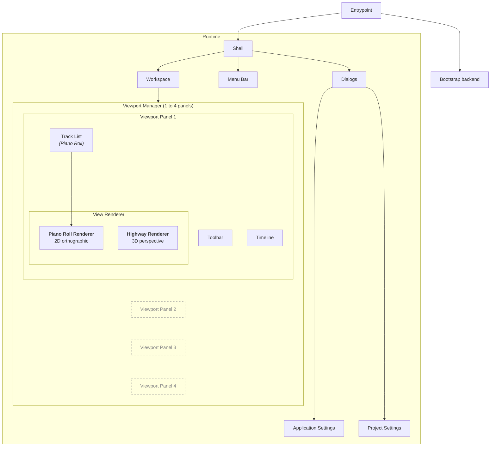
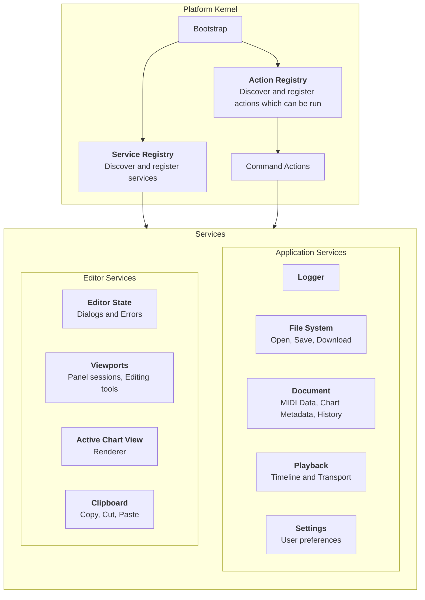

# Overview

OpenChart is a Typescript-based chart editor which provides a MIDI-native backend.

See also: [Vocals](vocals.md), [Rendering](rendering.md),
[Shared components](components.md), [Hotkeys](hotkeys.md) and
[Controls](../controls.md).

## Architecture

### Frontend

### Backend

