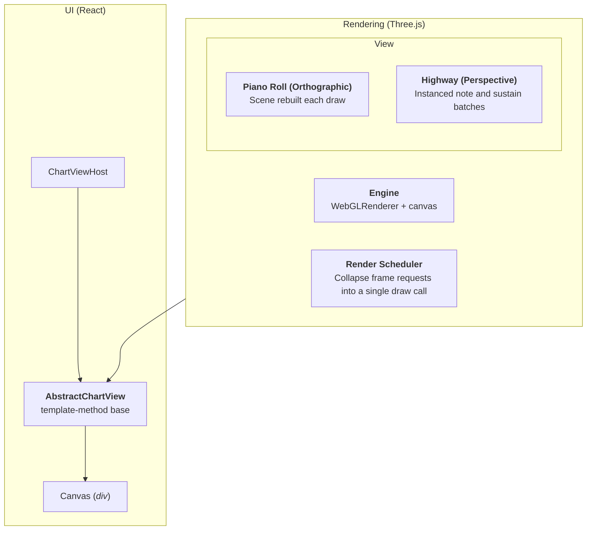

# Rendering

## Views

Each `ChartViewHost` creates its own `Engine` (and thus its own `THREE.WebGLRenderer`/WebGL context). With up
to four viewports, up to four contexts coexist. Assets are shared via the module-level `ResourceRegistry`.



## 2D Rendering

TODO

## 3D Rendering

All assets are bundler-resolved (nothing is fetched at runtime). As a result, validation is strict and
explicit upon compilation rather than at runtime. All assets are stored in a [global registry](../apps/editor/src/components/views/highway/geometryCatalog.ts).

A 3D asset consists of the approximate below file structure:

```
defs.json           # Declarative definition referencing these files
<type>/<type>.glb   # Mesh
<type>/<type>_D.png # Diffuse texture
<type>/<type>_E.png # Emissive texture
<type>/<type>_M.png # Emissive mask texture
```

`defs.json` is single [JSON file](../apps/editor/src/assets/defs.json) which defines
the different note and material permutations.

```jsonc
{
  "meshes": {
    "<name>": {
      // Mesh identifier
      "root": "string", // Root directory the remaining properties build a path from
      "mesh": "string", // .glb file
      "material": "string", // Material name (from "materials")
      "materialIds": "string[]", // Expected material IDs in the GLB mesh
      "tintedMaterialIds": "string[]", // Material IDs which receive a color tint
    },
    // Other meshes
  },
  "materials": {
    "<name>": {
      // Material identifier
      "vert": "vert.glsl", // Vertex shader file
      "pixel": "note.frag.glsl", // Pixel shader file
      "properties": {
        // Material properties
        "emissionTex": "string",
        "emissionMaskTex": "string",
        // Other properties
      },
    },
    // Other materials
  },
  "unusedAssets": {
    "Round/RoundNote_E2.png": "Unused",
    // Other unused assets
  },
}
```

### Geometry

All geometry is in .glb (GLTF) format. Meshes are shared by reference from the registry.

#### Highway instance batches

Highway notes are grouped by model kind and material role. Each GLB primitive is
rendered by one `THREE.InstancedMesh`; the primitives in a model share the same
instance-matrix and per-note state buffers. Baked CPU geometry is cached by
source geometry and transform, while each viewport owns its WebGL resources.

Sustain and cut-preview tails use separate instanced plane batches. Note start
ticks and sustain start/end ticks are stored per instance, and the vertex shader
derives world Z from the camera tick. Camera scrolling updates uniforms; note
instance buffers are rewritten only when the chart revision, selection, or
visible set changes.

Batches start at 256 entries, double as needed, and stop at 16,384. When a batch
exceeds its ceiling it retains instances nearest the strike line and reports
drops through the highway diagnostics. Low utilization shrinks capacity after
five seconds. The Debug window shows visible notes, visible sustains, dropped
items, and per-kind capacities.

Ghost notes, hover/marquee outlines, fret assemblies, beat lines, and phrase
spans remain ordinary scene objects. The Engine's opt-in framebuffer capture
also reports draw calls, triangles, geometry/texture counts, scene-object count,
and highway draw/buffer-write durations.
