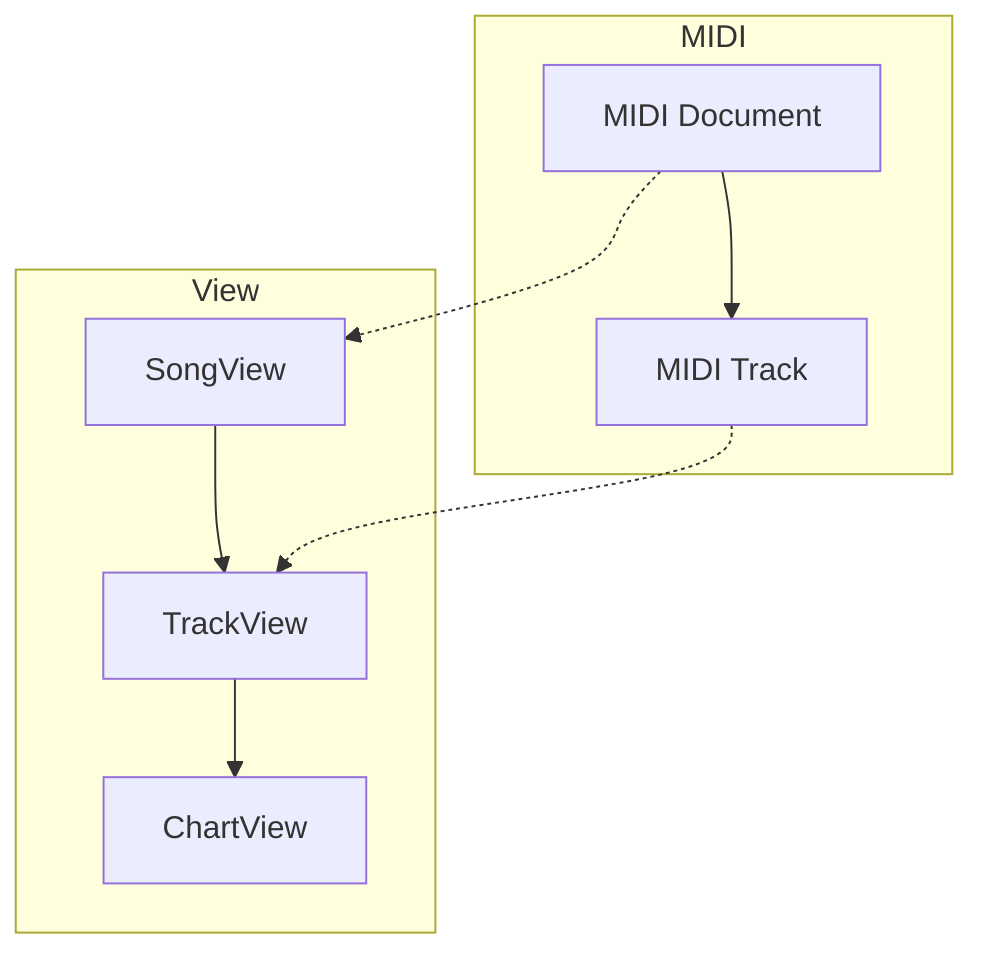

# `@openchart/views`

`@openchart/views` provides non-owning, chart-oriented views over MIDI data.
`SongView` maps MIDI tracks to configured instrument tracks and exposes
difficulty-specific `ChartView` objects. Edits made through a chart update the
underlying `MidiTrack`.

## Hierarchy

